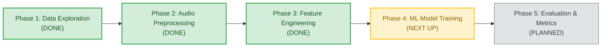
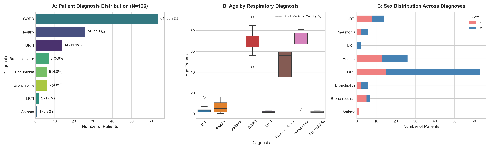
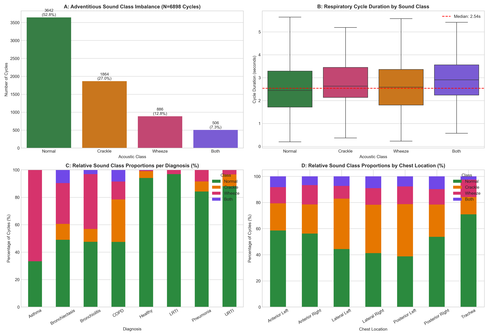
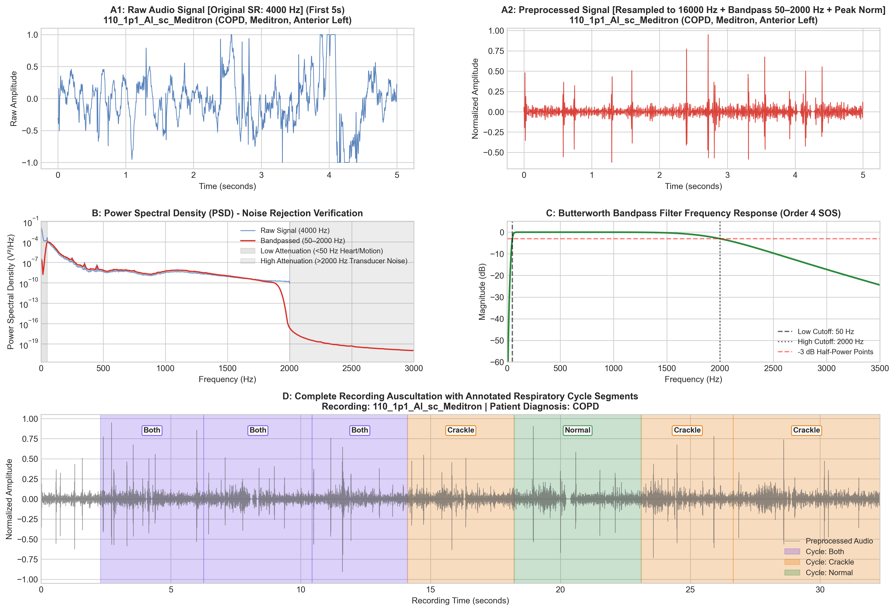
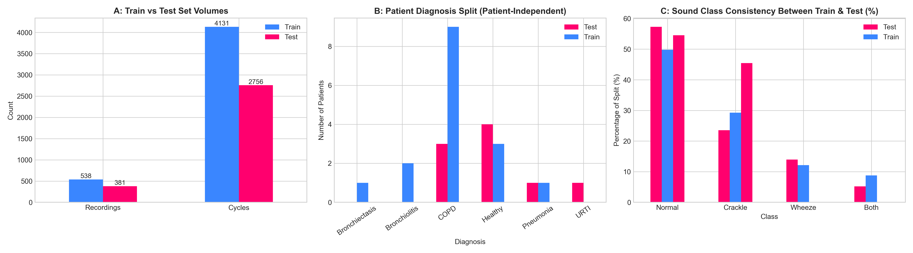
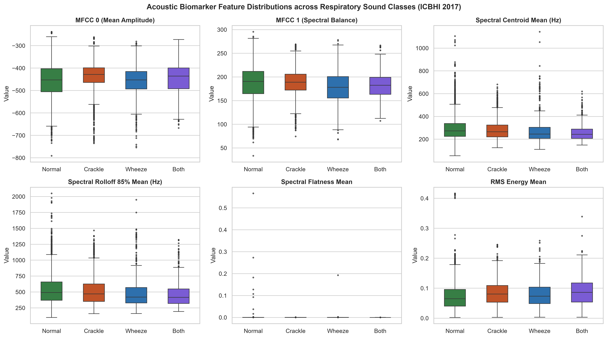
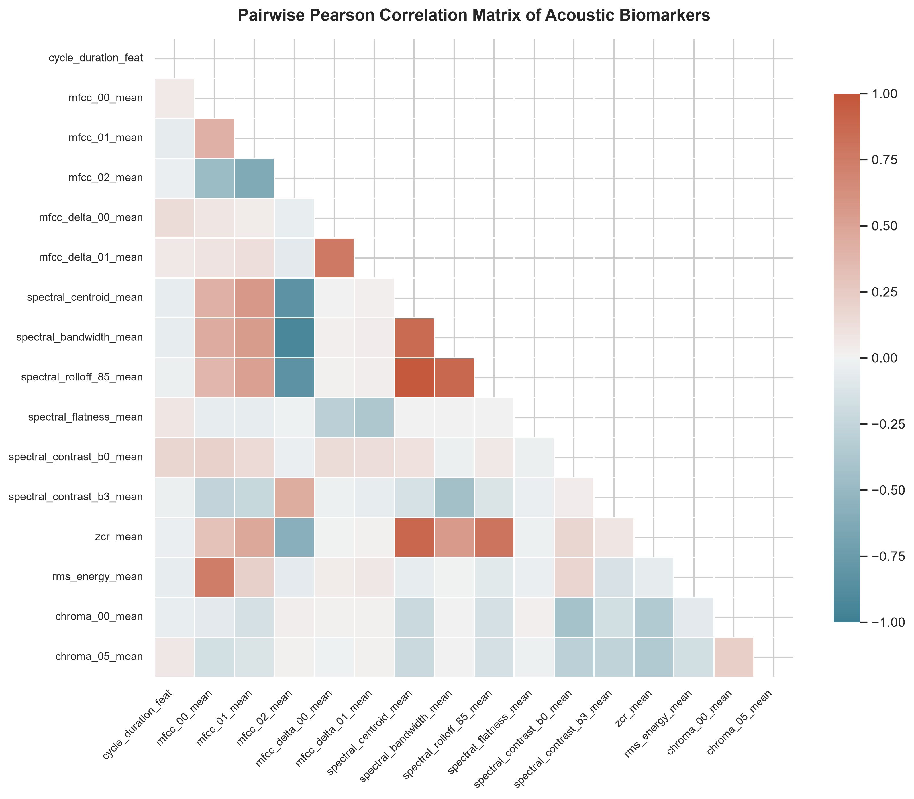
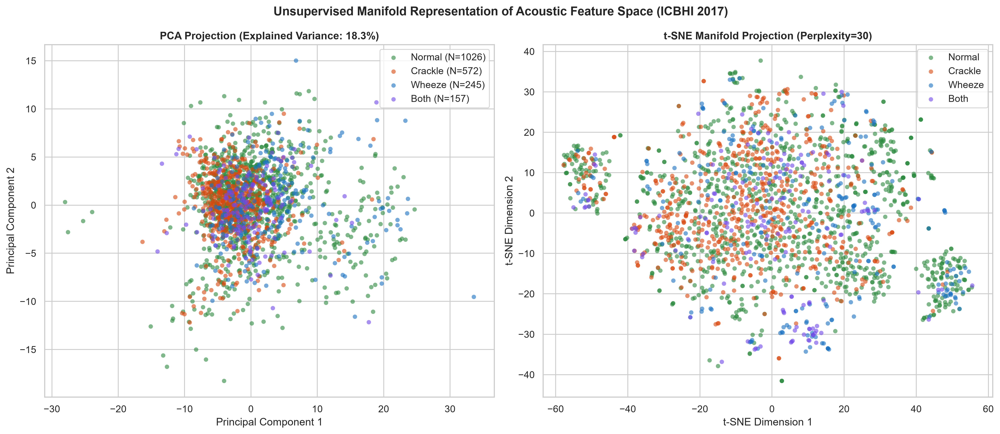

# ICBHI Respiratory Sound Detection

[](https://www.python.org/)
[](https://scikit-learn.org/)
[](https://bhichallenge.med.auth.gr/)
[](LICENSE)

An end-to-end Machine Learning pipeline to automatically detect respiratory diseases and abnormal lung sounds (**Crackles** and **Wheezes**) from digital stethoscope recordings.

---

## 📌 Project at a Glance

* **The Problem**: Doctors use stethoscopes to listen for lung diseases like COPD and Pneumonia. However, human interpretation is subjective and depends heavily on physician experience and ambient room noise.
* **The Goal**: Build an automated machine learning system that listens to digital stethoscope audio, identifies individual breath cycles, and classifies whether the breathing sound is **Normal**, contains **Crackles**, contains **Wheezes**, or **Both**.
* **The Dataset**: Official **ICBHI 2017 Challenge Database** (126 patients, 920 recordings, 6,898 annotated breath cycles).
* **Current Status**: **60% Complete (Phase 3 Done)**. Audio is resampled, bandpass-filtered, sliced into 6,898 clean breath cycles, and converted into 307 numerical acoustic features ready for machine learning model training.

---

## 🧭 Project Roadmap & Status



| Phase | Description | Status | Key Output |
| :--- | :--- | :---: | :--- |
| **Phase 1: Exploratory Data Analysis** | Analyze demographics, hardware, and sound distributions across 126 patients | `COMPLETED` | Summary tables (`.csv`) & Figures 1–6 |
| **Phase 2: Signal Preprocessing** | Standardize sampling rate (16 kHz), filter heart sounds (50–2,000 Hz bandpass), segment into breath cycles | `COMPLETED` | 6,898 segmented cycles & Figure 7 |
| **Phase 3: Feature Engineering** | Extract 307 acoustic features per cycle (MFCCs, pitch, spectral rolloff, loudness dynamics) | `COMPLETED` | `X_train.csv`, `X_test.csv` & Figures 8–10 |
| **Phase 4: ML Model Training** | Train & benchmark Random Forest, SVM, and XGBoost with class-balancing | `NEXT UP` | Trained classification models |
| **Phase 5: Clinical Evaluation** | Calculate official ICBHI Sensitivity, Specificity, and Score ($S_e + S_p)/2$ | `PLANNED` | Benchmark evaluation report |

---

## 🩺 The 4 Lung Sound Classes (What Are We Detecting?)

Each respiratory cycle falls into one of four clinically defined categories:

```
                  ┌──────────────────────────────┐
                  │   Respiratory Cycle Audio    │
                  └──────────────┬───────────────┘
                                 │
         ┌───────────────┬───────┴───────┬───────────────┐
         ▼               ▼               ▼               ▼
     [Normal]        [Crackle]       [Wheeze]          [Both]
     (52.8%)          (27.0%)         (12.8%)          (7.3%)
  Smooth breathing    Short popping  High-pitched     Both crackles &
    without any       clicks (like    whistle from     wheezes in the
   abnormalities      bubble wrap)    narrow airways     same breath
```

1. 🟢 **Normal (52.8%)**: Standard vesicular breath sound with smooth, low-frequency airflow and no obstructions.
2. 🟠 **Crackle (27.0%)**: Discontinuous, explosive popping sounds lasting less than 20–100 ms (like peeling Velcro or popping bubble wrap). Caused by sudden opening of collapsed small airways in **Pneumonia** and **Bronchiectasis**.
3. 🔵 **Wheeze (12.8%)**: Continuous, high-pitched musical whistling lasting over 100 ms. Caused by vibrating narrowed airways in **COPD** and **Asthma**.
4. 🟣 **Both (7.3%)**: Severe breath cycles where crackles and wheezes occur together in the same breath.

---

## 🔬 How Feature Engineering Works (Phase 3)

Machine learning models cannot take raw audio waves directly. We convert each breath cycle into **307 numerical measurements** grouped into 4 intuitive categories:

```
307 Extracted Acoustic Features per Breath Cycle:
├── 1. Sound Texture / Timbre (MFCCs: 240 features)
│      Captures the unique frequency profile and "voice" of the breath sound over time.
│
├── 2. Pitch & Brightness (Spectral Descriptors: 38 features)
│      Measures if the sound is high-pitched (whistling wheeze) or low-pitched (normal breath).
│
├── 3. Loudness & Pops (Temporal Dynamics: 9 features)
│      Measures rapid clicks, zero-crossings, and energy spikes caused by explosive crackles.
│
└── 4. Musical Tones (Chroma STFT: 24 features)
       Detects musical harmonics and definite pitch (wheezes have musical harmonic structure).
```

### Ready-to-Train Benchmark Datasets ([`data/processed/`](data/processed/))
Following the official ICBHI challenge partition, the data is split into patient-independent training and testing sets so models are evaluated on unseen patients:

* **Training Set (`X_train.csv`, `y_train.csv`)**: 4,142 cycles across 79 patients.
* **Testing Set (`X_test.csv`, `y_test.csv`)**: 2,756 cycles across 49 patients.
* **Master Feature Table (`features_all.csv`)**: All 6,898 cycles $\times$ 327 columns (metadata + features).
* **Feature Catalogue (`feature_names.json`)**: Plain text dictionary listing all 307 feature names.

---

## 📊 Visualizations

All publication-ready plots (300 DPI) are automatically generated in [`reports/figures/`](reports/figures/):

| 1. Disease & Demographics | 2. Sound Class Distribution |
| :---: | :---: |
|  |  |

| 3. Audio Filtering & Segmentation | 4. Benchmark Train / Test Split |
| :---: | :---: |
|  |  |

| 5. Acoustic Biomarker Boxplots | 6. Feature Correlation Heatmap |
| :---: | :---: |
|  |  |

| 7. 2D Cluster Visualizations (PCA & t-SNE) |
| :---: |
|  |

---

## ⚡ Quick Start: How to Run

### 1. Setup Environment
Clone the repository and install the standard scientific Python packages:
```bash
git clone https://github.com/Simplicity005/icbhi-respiratory-detection.git
cd icbhi-respiratory-detection
pip install numpy pandas scipy scikit-learn matplotlib seaborn librosa soundfile soxr
```

### 2. Run Data Exploration (Phase 1)
Generates patient demographic tables and Figures 1 to 6:
```bash
python scripts/run_eda.py
```

### 3. Run Preprocessing & Segmentation (Phase 2)
Filters raw audio (50–2,000 Hz) and segments continuous recordings into individual breath cycles:
```bash
python scripts/preprocess_and_segment.py
```

### 4. Run Feature Extraction (Phase 3)
Extracts all 307 acoustic features using parallel processing across CPU cores:
```bash
python scripts/extract_features.py --workers 8
```

### 5. Open Interactive Notebooks
Explore the pipeline interactively in Jupyter or VS Code:
* [`notebooks/01_ICBHI_Exploratory_Data_Analysis.ipynb`](notebooks/01_ICBHI_Exploratory_Data_Analysis.ipynb): Interactive demographic & sound exploration.
* [`notebooks/02_Preprocessing_and_Segmentation.ipynb`](notebooks/02_Preprocessing_and_Segmentation.ipynb): Interactive Butterworth filtering and audio slicing.
* [`notebooks/03_Feature_Engineering.ipynb`](notebooks/03_Feature_Engineering.ipynb): Interactive acoustic feature exploration, spectrograms, and PCA/t-SNE clusters.

---

## 📁 Repository Structure

```
icbhi-respiratory-detection/
├── data/
│   ├── metadata/                       # Official ICBHI challenge text files
│   └── processed/                      # Preprocessed datasets ready for ML
│       ├── X_train.csv                 # 4,142 train cycles × 307 features
│       ├── y_train.csv                 # Train labels (Normal, Crackle, Wheeze, Both)
│       ├── X_test.csv                  # 2,756 test cycles × 307 features
│       ├── y_test.csv                  # Test labels
│       ├── features_all.csv            # Master dataset (6,898 cycles × 327 columns)
│       ├── feature_names.json          # Dictionary of all 307 features
│       └── segmented_cycles_metadata.csv # Timing boundaries for each cycle
├── notebooks/
│   ├── 01_ICBHI_Exploratory_Data_Analysis.ipynb
│   ├── 02_Preprocessing_and_Segmentation.ipynb
│   └── 03_Feature_Engineering.ipynb
├── reports/
│   └── figures/                        # High-resolution (300 DPI) publication figures
├── scripts/
│   ├── run_eda.py                      # Phase 1 runner
│   ├── preprocess_and_segment.py       # Phase 2 runner
│   └── extract_features.py             # Phase 3 runner
├── .gitignore
└── README.md
```

---

## 📈 Evaluation Metrics (What We Optimize For)

In respiratory sound detection, accuracy alone is misleading because healthy sounds outnumber abnormal sounds. Following the official ICBHI challenge standard, we evaluate models using:

1. **Sensitivity ($S_e$)**: Ability to correctly detect abnormal breath sounds (Crackles and Wheezes).
$$\text{Sensitivity} = \frac{\text{True Positives}}{\text{True Positives} + \text{False Negatives}}$$

2. **Specificity ($S_p$)**: Ability to correctly identify normal healthy breathing.
$$\text{Specificity} = \frac{\text{True Negatives}}{\text{True Negatives} + \text{False Positives}}$$

3. **ICBHI Composite Score**: The balanced clinical average:
$$\text{ICBHI Score} = \frac{S_e + S_p}{2}$$

---

## 📚 References
* **ICBHI 2017 Challenge**: Rocha, B.M., et al. *"An open access database for the evaluation of respiratory sound classification algorithms."* Physiological Measurement 40.3 (2019): 035001. [Challenge Portal](https://bhichallenge.med.auth.gr/)
