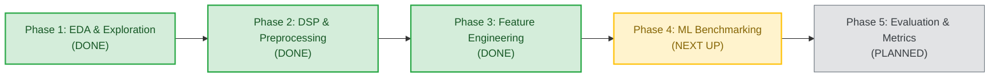
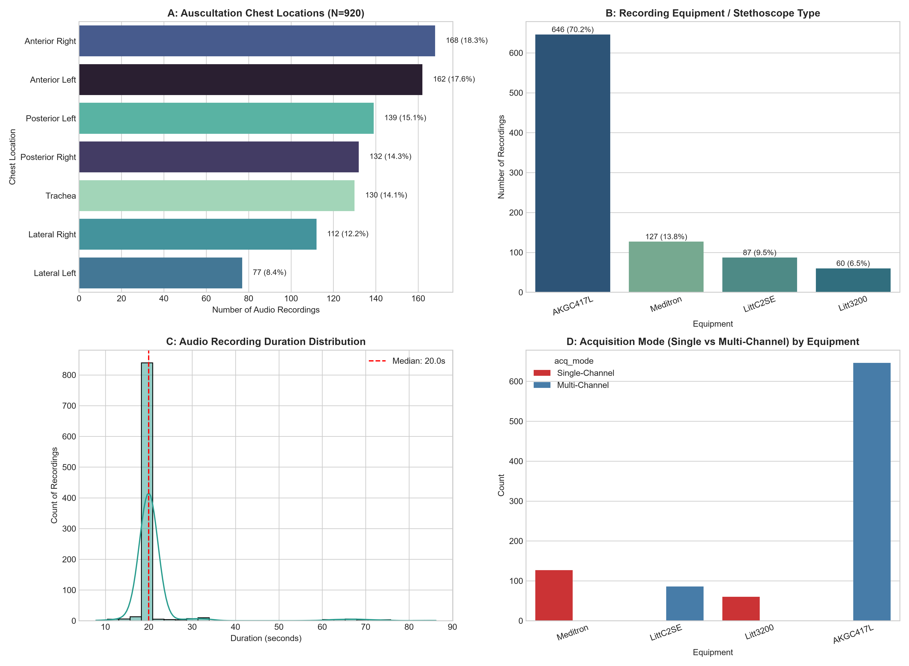
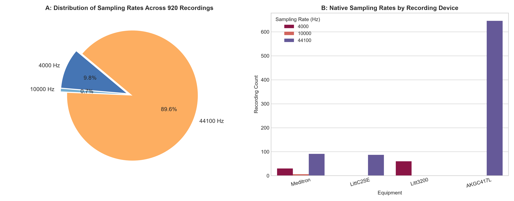
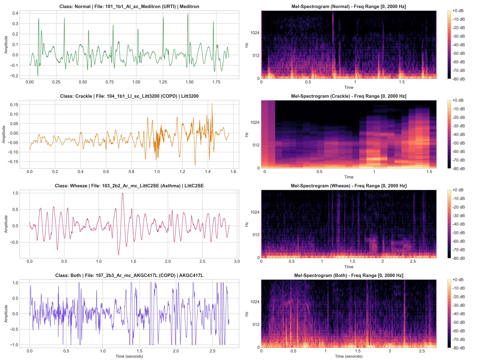

# ICBHI Respiratory Disease Detection

[](https://www.python.org/)
[](https://scikit-learn.org/)
[](https://bhichallenge.med.auth.gr/)
[](LICENSE)

An end-to-end classical machine learning pipeline for automated respiratory disease and adventitious sound detection using acoustic biomarkers from the **ICBHI 2017 Respiratory Sound Database**.

---

## Table of Contents
- [Overview](#overview)
- [Project Status & Roadmap](#project-status--roadmap)
- [Dataset Summary](#dataset-summary)
- [Key Exploratory Data Analysis (EDA) Findings](#key-exploratory-data-analysis-eda-findings)
- [Preprocessing & Segmentation Pipeline](#preprocessing--segmentation-pipeline)
- [Acoustic Feature Engineering (Phase 3)](#acoustic-feature-engineering-phase-3)
- [Visualizations](#visualizations)
- [Machine Learning Architecture](#machine-learning-architecture)
- [Repository Structure](#repository-structure)
- [Getting Started](#getting-started)
- [Evaluation Metrics](#evaluation-metrics)
- [References](#references)

---

## Overview

Auscultation of respiratory sounds using stethoscopes is a primary clinical method for diagnosing pulmonary disorders such as Chronic Obstructive Pulmonary Disease (COPD), Pneumonia, and Bronchiectasis. However, manual interpretation is subjective and operator-dependent.

This repository implements a **classical machine learning workflow** utilizing handcrafted digital signal processing (DSP) feature extraction:
1. **Signal Preprocessing**: Butterworth bandpass filtering (50–2,000 Hz) and standardized resampling to handle multi-hardware stethoscope data.
2. **Feature Engineering**: Time-frequency representation using Mel-Frequency Cepstral Coefficients (MFCCs), spectral descriptors (Centroid, Rolloff, Contrast, Flatness), and temporal dynamics (ZCR, RMS energy).
3. **Classification**: Benchmarking **Random Forest** (with cost-sensitive class balancing) against **Support Vector Machines (SVM)** and **Gradient Boosting (XGBoost)**.
4. **Validation**: Patient-independent evaluation following the official ICBHI challenge benchmark to prevent data leakage.

---

## Project Status & Roadmap

> **Current Milestone**: **Phase 3 (Acoustic Feature Engineering) Complete** &mdash; Ready for **Phase 4 (Classical Machine Learning & Benchmarking)**.  
> **Overall Progress**: `[████████████░░░░░░░░] 60% (3 / 5 Core Phases Completed)`



### Detailed Roadmap & Deliverables

- [x] **Phase 1: Exploratory Data Analysis & Metadata Structuring** *(Completed)*
  - [x] Audit 126 subjects, 920 recordings, and 6,898 respiratory cycles.
  - [x] Analyze disease distributions, recording hardware, and auscultation chest sites.
  - [x] Verify official patient-independent train/test benchmark split (79 train / 49 test).
  - [x] Extract summary CSVs (`patients_summary.csv`, `recordings_summary.csv`, `cycles_summary.csv`).
  - [x] Produce publication-ready visualization figures (`fig1` through `fig6`).
  - [x] Pipeline automation via [`scripts/run_eda.py`](scripts/run_eda.py) and [`notebooks/01_ICBHI_Exploratory_Data_Analysis.ipynb`](notebooks/01_ICBHI_Exploratory_Data_Analysis.ipynb).

- [x] **Phase 2: Signal Preprocessing & Respiratory Cycle Segmentation** *(Completed)*
  - [x] High-fidelity sinc resampling to standard 16 kHz sampling rate (`soxr`).
  - [x] 4th-order zero-phase Butterworth bandpass filter (50–2,000 Hz) to eliminate cardiac murmur (<50 Hz) and high-frequency noise.
  - [x] Zero-DC offset demeaning and peak amplitude normalization (0.95).
  - [x] Slice continuous audio into 6,898 clean cycle `.wav` files stored in `data/processed/segmented_cycles/`.
  - [x] Generate master metadata table `data/processed/segmented_cycles_metadata.csv` with cycle durations, class labels, and split indicators.
  - [x] Generate signal processing visualization (`fig7_preprocessing_and_segmentation.png`).
  - [x] Pipeline automation via [`scripts/preprocess_and_segment.py`](scripts/preprocess_and_segment.py) and [`notebooks/02_Preprocessing_and_Segmentation.ipynb`](notebooks/02_Preprocessing_and_Segmentation.ipynb).

- [x] **Phase 3: Acoustic Feature Engineering** *(Completed)*
  - [x] Extract 307 handcrafted acoustic biomarker features per respiratory cycle:
    - **MFCCs** (20 coefficients + $\Delta$ + $\Delta\Delta$ $\times$ 4 summary statistics = 240 features).
    - **Spectral Descriptors** (Centroid, Bandwidth, Rolloff 85% & 95%, Flatness, 7-band Contrast = 38 features).
    - **Temporal Dynamics** (Zero-Crossing Rate, RMS Energy, Cycle Duration = 9 features).
    - **Tonal / Wheeze Biomarkers** (Chroma STFT across 12 pitch classes = 24 features).
  - [x] Export structured official benchmark matrices:
    - Master table: `features_all.csv` (6,898 cycles $\times$ 327 columns).
    - Benchmark split: `X_train.csv` (4,142 $\times$ 307) and `X_test.csv` (2,756 $\times$ 307).
    - Target labels: `y_train.csv` and `y_test.csv` (4-class `class_id` + binary `is_adventitious`).
    - Subgroup metadata: `metadata_train.csv` and `metadata_test.csv`.
    - Catalogue: `feature_names.json` (complete structured feature dictionary).
  - [x] Publication-ready verification figures (`fig8_acoustic_features_distribution.png`, `fig9_feature_correlation_matrix.png`, `fig10_pca_tsne_feature_space.png`).
  - [x] Multi-core parallel feature extraction script [`scripts/extract_features.py`](scripts/extract_features.py) (242 seconds execution across 920 recordings).
  - [x] Interactive walkthrough notebook [`notebooks/03_Feature_Engineering.ipynb`](notebooks/03_Feature_Engineering.ipynb).

- [ ] **Phase 4: Classical Machine Learning & Model Training** *(Next Up)*
  - [ ] Benchmark baseline classifiers:
    - **Random Forest** (primary model with `class_weight="balanced"`).
    - **Support Vector Machine (SVM)** with RBF kernel and standard feature scaling.
    - **Gradient Boosting** (XGBoost / LightGBM).
  - [ ] Formulate target prediction tasks:
    - **4-Class Classification**: Normal vs. Crackle vs. Wheeze vs. Both.
    - **2-Class Classification**: Normal vs. Adventitious (abnormal).
  - [ ] Address class imbalance using cost-sensitive learning and SMOTE / audio data augmentation.
  - [ ] Hyperparameter tuning using patient-grouped cross-validation (`GroupKFold`) on the training cohort.

- [ ] **Phase 5: Evaluation, Error Analysis & Interpretability** *(Planned)*
  - [ ] Evaluate on unseen test cohort using official ICBHI metrics: Sensitivity ($S_e$), Specificity ($S_p$), and ICBHI Score ($\frac{S_e + S_p}{2}$).
  - [ ] Compute multi-class confusion matrices, ROC-AUC, and per-class precision/recall curves.
  - [ ] Feature importance ranking (MDI / permutation importance / SHAP) to validate acoustic biomarker clinical relevance.
  - [ ] Hardware and anatomical site error breakdown to evaluate cross-device robustness.

- [ ] **Phase 6: Extensions & Interactive Auscultation Demo** *(Future)*
  - [ ] Deep learning comparison (e.g., 2D CNN / ResNet on log-Mel spectrograms).
  - [ ] Lightweight web interface (Streamlit / Gradio) allowing users to upload stethoscope audio, visualize filtered waveforms and spectrograms, and obtain automated diagnostic predictions.

---

## Dataset Summary

The **ICBHI 2017 Challenge Database** consists of respiratory sound recordings acquired from 126 subjects across two clinical research centers (Portugal and Greece).

* **Subjects**: 126 patients (76 adults, 49 pediatric, 1 unrecorded)
* **Audio Recordings**: 920 `.wav` files (5.49 total hours)
* **Annotated Cycles**: 6,898 complete respiratory cycles labeled for crackles and wheezes
* **Hardware**: 4 distinct acquisition devices (AKG C417L microphone, 3M Littmann Classic II SE, 3M Littmann 3200, WelchAllyn Meditron)
* **Chest Locations**: 7 anatomical auscultation sites (Trachea, Anterior L/R, Posterior L/R, Lateral L/R)

---

## Key Exploratory Data Analysis (EDA) Findings

### 1. Patient Demographics & Diagnoses
| Disease Diagnosis | Patients ($N$) | Percentage (%) | Primary Age Group | Clinical Notes |
| :--- | :---: | :---: | :---: | :--- |
| **COPD** | 64 | 50.79% | 55 – 84 yrs | Continuous wheezes & crackles |
| **Healthy** | 26 | 20.63% | 0.5 – 60 yrs | Vesicular breath sounds |
| **URTI** | 14 | 11.11% | 1 – 15 yrs | Pediatric upper airway infections |
| **Bronchiectasis** | 7 | 5.56% | 50 – 78 yrs | Persistent coarse crackles |
| **Pneumonia** | 6 | 4.76% | 20 – 75 yrs | Mid/late inspiratory crackles |
| **Bronchiolitis** | 6 | 4.76% | 0.25 – 2 yrs | Exclusively infant cohort (<2 yrs) |
| **LRTI** | 2 | 1.59% | 3 – 58 yrs | Lower respiratory tract infection |
| **Asthma** | 1 | 0.79% | 70 yrs | Expiratory musical wheezing |

### 2. Adventitious Sound Classes (Cycle-Level)
| Class ID | Sound Category | Cycles ($N$) | Percentage (%) | Mean Duration (s) |
| :---: | :--- | :---: | :---: | :---: |
| **0** | **Normal** (No crackles, no wheezes) | 3,642 | 52.80% | $2.73 \pm 1.18$ |
| **1** | **Crackle Only** (Discontinuous) | 1,864 | 27.02% | $2.64 \pm 1.13$ |
| **2** | **Wheeze Only** (Continuous tonal) | 886 | 12.84% | $2.72 \pm 1.22$ |
| **3** | **Both** (Crackle + Wheeze) | 506 | 7.34% | $2.69 \pm 1.14$ |

### 3. Sampling Rate Heterogeneity
Audio recordings have varying native sampling frequencies:
* **44,100 Hz**: 824 files (89.57%)
* **4,000 Hz**: 90 files (9.78%)
* **10,000 Hz**: 6 files (0.65%)
* *Implication*: Resampling all audio to a uniform sampling rate (e.g., 4 kHz or 16 kHz) is required before feature extraction.

### 4. Official Benchmark Split (Patient-Independent)
* **Training Set**: 538 recordings (4,131 cycles) across 79 patients.
* **Testing Set**: 382 recordings (2,756 cycles) across 49 patients.
* *Zero patient leakage* ensures realistic clinical generalization.

---

## Preprocessing & Segmentation Pipeline

Raw stethoscope audio recordings present significant challenges: heterogeneous sampling rates (4 kHz to 44.1 kHz), heart sound contamination (<50 Hz), and varying cycle durations. The preprocessing pipeline standardizes the acoustic signals:

1. **Standardized Resampling (16 kHz)**:
   * Converted all recordings from native sampling frequencies to 16,000 Hz using high-quality sinc resampling (`soxr`) to establish a uniform time-frequency basis.
2. **Butterworth Bandpass Filter (50–2,000 Hz)**:
   * **Low Cutoff (50 Hz)**: Suppresses low-frequency cardiac sounds (S1, S2, murmurs), chest wall friction, and body motion rumble.
   * **High Cutoff (2,000 Hz)**: Filters out high-frequency sensor hiss, powerline harmonics, and environmental background noise.
   * **Implementation**: 4th-order Second-Order Sections (SOS) with bidirectional zero-phase digital filtering (`scipy.signal.sosfiltfilt`).
3. **Signal Normalization**:
   * Removed DC offset (mean demeaning) and scaled peak amplitude to 0.95 to eliminate numerical saturation and boundary clipping.
4. **Clinical Cycle Segmentation**:
   * Slices each recording into expert-annotated respiratory cycles, yielding **6,898 individual cycle `.wav` files** in `data/processed/segmented_cycles/` accompanied by a master metadata table `data/processed/segmented_cycles_metadata.csv`.

---

## Acoustic Feature Engineering (Phase 3)

In Phase 3, each of the **6,898 segmented respiratory cycles** is transformed into a **307-dimensional handcrafted acoustic feature vector** designed to capture clinical auscultation biomarkers:

### 1. Acoustic Biomarker Taxonomy (307 Features)
| Domain | Biomarkers Extracted | Statistics / Bands | Dims ($D$) | Clinical Diagnostic Relevance |
| :--- | :--- | :--- | :---: | :--- |
| **MFCCs** | 20 Mel-Frequency Cepstral Coefficients | Mean, Std, Skew, Kurtosis | 80 | Acoustic vocal tract envelope & airway geometry |
| **Delta MFCCs ($\Delta$)** | 1st temporal velocity derivative | Mean, Std, Skew, Kurtosis | 80 | Rate of spectral change, onset of explosive crackles |
| **Delta-Delta ($\Delta\Delta$)** | 2nd temporal acceleration derivative | Mean, Std, Skew, Kurtosis | 80 | Non-stationary acoustic acceleration |
| **Spectral Descriptors** | Centroid, Bandwidth, Rolloff (85% & 95%), Flatness | Mean, Std, Skew, Kurtosis | 24 | High-frequency emphasis; tonality vs. noise discrimination |
| **Spectral Contrast** | Peak-to-valley energy difference across 7 octave sub-bands | Mean, Std per band | 14 | Harmonic prominence vs. background rumble |
| **Temporal Dynamics** | Zero-Crossing Rate (ZCR) & RMS Energy | Mean, Std, Skew, Kurtosis | 8 | Discontinuous clicks/pops and respiratory cycle energy |
| **Tonal / Wheeze Descriptors** | Chroma STFT across 12 pitch classes | Mean, Std per semitone | 24 | Pitch/tonal harmonic resonances characteristic of wheezing |
| **Cycle Duration** | Duration of respiratory cycle in seconds | Direct duration | 1 | Tachypnea and respiratory rate variation |
| **Total Features** | | | **307** | **Comprehensive Auscultation Feature Matrix** |

### 2. Official Benchmark Matrix Breakdown
The extracted feature matrices are saved in `data/processed/` conforming to the official ICBHI challenge benchmark split:
* **`X_train.csv` / `y_train.csv`**: 4,142 cycles $\times$ 307 features across 79 subjects.
* **`X_test.csv` / `y_test.csv`**: 2,756 cycles $\times$ 307 features across 49 subjects.
* **`features_all.csv`**: Master matrix of all 6,898 cycles $\times$ 327 columns (20 metadata + 307 features).
* **`feature_names.json`**: Structured catalogue of all 307 feature identifiers categorized by domain.

---

## Visualizations

All high-resolution figures are automatically generated by the pipelines and saved in `reports/figures/`:

| Disease & Demographics | Recording Acquisition Breakdown |
| :---: | :---: |
|  |  |

| Sampling Rate Heterogeneity | Adventitious Sound Breakdown |
| :---: | :---: |
|  |  |

| Train/Test Benchmark Split | Spectrograms & Waveforms |
| :---: | :---: |
|  |  |

| Preprocessing & Respiratory Cycle Segmentation |
| :---: |
|  |

| Acoustic Biomarker Distributions | Feature Correlation Matrix |
| :---: | :---: |
|  |  |

| Unsupervised Manifold Projections (PCA & t-SNE) |
| :---: |
|  |

---

## Machine Learning Architecture

```
Raw Audio (.wav)
      │
      ▼
[Preprocessing] ──► Butterworth Bandpass (50–2000 Hz) + Resampling (16 kHz)
      │
      ▼
[Segmentation]  ──► Cut into annotated respiratory cycles (start_time to end_time)
      │
      ▼
[Feature Extraction (Phase 3)]
      ├── 20 MFCCs + Δ + ΔΔ (Mean, Std, Skewness, Kurtosis: 240 features)
      ├── Spectral Centroid, Bandwidth, Rolloff (85% & 95%), Flatness, Contrast (38 features)
      ├── Zero-Crossing Rate (ZCR) & RMS Energy (8 features)
      ├── Chroma STFT (12 semitones: 24 features)
      └── Cycle Duration (1 feature) ──► 307 Total Features
      │
      ▼
[Official Benchmark Split] ──► X_train (4,142 × 307) & X_test (2,756 × 307)
      │
      ▼
[Class Balancing] ──► Cost-sensitive learning (`class_weight="balanced"`) or SMOTE
      │
      ▼
[Model Training & Evaluation (Phase 4)]
      ├── Random Forest (Primary Baseline)
      ├── Support Vector Machine (SVM - RBF kernel)
      └── Gradient Boosting (XGBoost / LightGBM)
```

---

## Repository Structure

```
icbhi-respiratory-detection/
├── data/
│   ├── metadata/                       # Official challenge text files
│   │   ├── ICBHI_Challenge_demographic_information.txt
│   │   ├── ICBHI_Challenge_diagnosis.txt
│   │   ├── ICBHI_challenge_train_test.txt
│   │   └── filename_differences.txt
│   └── processed/                      # Extracted feature matrices & summary tables
│       ├── features_all.csv            # Master matrix: 6,898 cycles × 327 columns
│       ├── X_train.csv                 # Train feature matrix: 4,142 cycles × 307 features
│       ├── y_train.csv                 # Train labels (class_id + binary is_adventitious)
│       ├── metadata_train.csv          # Train cycle metadata (patient, device, location)
│       ├── X_test.csv                  # Test feature matrix: 2,756 cycles × 307 features
│       ├── y_test.csv                  # Test labels (class_id + binary is_adventitious)
│       ├── metadata_test.csv           # Test cycle metadata (patient, device, location)
│       ├── feature_names.json          # Structured dictionary of all 307 feature names
│       ├── segmented_cycles_metadata.csv # Master cycle timing annotations
│       ├── patients_summary.csv        # Demographic summary table
│       ├── recordings_summary.csv      # Audio recording metadata table
│       └── cycles_summary.csv          # Respiratory cycle metadata table
├── notebooks/
│   ├── 01_ICBHI_Exploratory_Data_Analysis.ipynb     # Interactive EDA walkthrough
│   ├── 02_Preprocessing_and_Segmentation.ipynb    # Interactive DSP & filtering walkthrough
│   └── 03_Feature_Engineering.ipynb               # Interactive acoustic biomarker walkthrough
├── reports/
│   └── figures/                        # High-resolution (300 DPI) publication plots
│       ├── fig1_disease_and_demographics.png
│       ├── fig2_recording_acquisition_breakdown.png
│       ├── fig3_sampling_rate_heterogeneity.png
│       ├── fig4_respiratory_cycles_adventitious_sounds.png
│       ├── fig5_train_test_distribution.png
│       ├── fig6_audio_spectrogram_examples.png
│       ├── fig7_preprocessing_and_segmentation.png
│       ├── fig8_acoustic_features_distribution.png
│       ├── fig9_feature_correlation_matrix.png
│       └── fig10_pca_tsne_feature_space.png
├── scripts/
│   ├── run_eda.py                      # Standalone EDA pipeline runner
│   ├── preprocess_and_segment.py       # Butterworth DSP filtering & cycle segmentation
│   └── extract_features.py             # Multi-core 307-feature extraction pipeline
├── .gitignore
└── README.md
```

---

## Getting Started

### 1. Prerequisites & Environment Setup
Clone the repository and install required packages:
```bash
git clone https://github.com/Simplicity005/icbhi-respiratory-detection.git
cd icbhi-respiratory-detection
pip install numpy pandas scipy scikit-learn matplotlib seaborn librosa soundfile soxr
```

### 2. Run the EDA Pipeline
To regenerate all summary tables and visualization figures:
```bash
python scripts/run_eda.py
```

### 3. Run Preprocessing & Cycle Segmentation
To perform sampling rate standardization (16 kHz), 4th-order zero-phase Butterworth bandpass filtering (50–2,000 Hz), peak normalization, and slice into 6,898 respiratory cycles:
```bash
python scripts/preprocess_and_segment.py
```

### 4. Run Acoustic Feature Engineering Pipeline
To extract all 307 handcrafted features in parallel across 8 CPU workers and export `X_train`, `X_test`, `y_train`, `y_test`:
```bash
python scripts/extract_features.py --workers 8
```

### 5. Open Interactive Notebooks
Launch Jupyter or open directly in VS Code:
```bash
jupyter notebook notebooks/01_ICBHI_Exploratory_Data_Analysis.ipynb
jupyter notebook notebooks/02_Preprocessing_and_Segmentation.ipynb
jupyter notebook notebooks/03_Feature_Engineering.ipynb
```

---

## Evaluation Metrics

Following official ICBHI challenge conventions, performance is measured using Sensitivity, Specificity, and the composite ICBHI Score to avoid skewed accuracy under class imbalance:

$$\text{Sensitivity } (S_e) = \frac{\text{TP}}{\text{TP} + \text{FN}} \quad \text{(Detection of abnormal adventitious sounds)}$$

$$\text{Specificity } (S_p) = \frac{\text{TN}}{\text{TN} + \text{FP}} \quad \text{(Correct identification of normal breath)}$$

$$\text{ICBHI Score} = \frac{S_e + S_p}{2}$$

---

## References
* **ICBHI 2017 Challenge**: Rocha, B.M., et al. *"An open access database for the evaluation of respiratory sound classification algorithms."* Physiological Measurement 40.3 (2019): 035001. [Challenge Portal](https://bhichallenge.med.auth.gr/)
